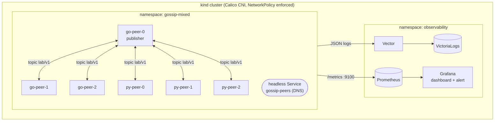

# gossipsub-k8s-lab

An observable [GossipSub](https://github.com/libp2p/specs/tree/master/pubsub/gossipsub) network on Kubernetes.
Six peers share one topic, one of them publishes, and every receipt is measured. You can cut two peers off with a
NetworkPolicy, watch the network react in Grafana, and see an alert fire and clear.

Two libp2p implementations run in the same mesh:

| Role | Implementation | Version |
|---|---|---|
| Primary | Go: go-libp2p + go-libp2p-pubsub | v0.51.0 / v0.19.0 |
| Second | Python: py-libp2p | 0.8.1 |

---

## 🧭 Architecture



How it fits together:

- **Peers** run as StatefulSets. Each derives a fixed peer ID from its name, and finds the others by DNS name through a
  headless Service, so no pod IPs are hard-coded.
- **The publisher** (`go-peer-0`) sends 10 messages per second with 1 KiB payloads. Each message carries a run ID,
  publisher ID, sequence number, and publish timestamp.
- **Every peer** exposes the same Prometheus metrics and JSON log fields, whatever its language, so one dashboard
  covers both implementations.
- **The failure test** applies a NetworkPolicy that cuts `go-peer-2` and `py-peer-2` off from the other four.
  The two isolated peers can still reach each other.

A second namespace, `gossip-lab`, runs six Go-only peers as the primary-implementation baseline.

---

## ✅ Prerequisites

| Tool | Tested with | Used for |
|---|---|---|
| [Docker Desktop](https://www.docker.com/products/docker-desktop/) | 28.3 | Builds the images and runs the kind node. Give it at least **8 GB of memory** and 4 CPUs. |
| [kind](https://kind.sigs.k8s.io/) | 0.31 | The local cluster (Kubernetes 1.34, Calico CNI) |
| [kubectl](https://kubernetes.io/docs/tasks/tools/) | 1.32 | Everything that talks to the cluster |
| [Helm](https://helm.sh/) | 3.18 | Prometheus, Grafana, Vector, and VictoriaLogs |
| GNU Make | 3.81 | The `make` targets |
| Python 3 | 3.9 | Dashboard generation and result analysis (standard library only, no `pip install`) |
| `curl` | any | Downloads the Calico manifest |
| Go *(optional)* | 1.26 | Only to run the Go unit tests on the host. The images build Go inside Docker. |

On macOS, install everything with Homebrew:

```bash
brew install --cask docker
brew install kind kubectl helm python@3
```

`make`, `curl`, and `caffeinate` (used by the test targets to keep the Mac awake) ship with macOS. On Linux, drop
`caffeinate` from the `test-scenario*` targets in the `Makefile`.

You also need network access to Docker Hub, quay.io, registry.k8s.io, and the Helm chart repositories. Check your
setup:

```bash
docker info --format '{{.MemTotal}}' && kind version && kubectl version --client && helm version --short && python3 --version
```

**You should see** a memory value above 8000000000, then a version line for each tool.

---

## 🚀 Quick start

```bash
make up
```

That one command creates the cluster, builds and loads the images, deploys both networks, installs the
observability stack, and starts the port-forwards. Then open Grafana:

| Tool | URL | Login |
|---|---|---|
| Grafana | http://localhost:3100 | `admin` / `lab-admin` |
| Prometheus | http://localhost:9090 | |
| VictoriaLogs | http://localhost:9428 | |

---

## 🪜 Step by step

Prefer to go one step at a time? Run these in order, and check what you should see before moving on.

### 1. Create the cluster (about 1 to 2 minutes)

```bash
make cluster-up
```

**You should see**

- The script prints progress and ends with `READY: node Ready, 9/9 kube-system pods running`

### 2. Build and load the images

```bash
make build
```

**You should see**

- `gossip/go-peer:0.1.1` and `gossip/py-peer:0.1.5` are built and loaded into kind

<details>
<summary>Build fails with <code>auth.docker.io: i/o timeout</code>?</summary>

Docker Desktop's DNS can fail even when your machine resolves names fine. If the images already exist locally,
load them and skip the build:

```bash
kind load docker-image gossip/go-peer:0.1.1 gossip/py-peer:0.1.5 --name gossip-lab
```
</details>

### 3. Deploy the peers (under a minute each)

```bash
make deploy-go-only    # six Go peers, namespace gossip-lab
make deploy-mixed      # three Go + three Python peers, namespace gossip-mixed
make status
```

**You should see**

- Six pods Running in `gossip-lab`
- Six pods Running in `gossip-mixed`, with no restarts

### 4. Install observability (a few minutes)

```bash
make observability
```

**You should see**

- Script ends with `DONE`
- Grafana, Prometheus, Vector, and VictoriaLogs pods are Running in `observability`

### 5. Open the dashboards

```bash
make forward
```

**You should see**

- Grafana opens at http://localhost:3100
- **Dashboards → GossipSub Lab → GossipSub lab** shows data after a couple of minutes
- Every peer reports 5 connected peers
- Delivery ratio is close to 100% for every subscriber

---

## 🧪 Run the experiments

### Baseline (scenario 1)

**One command** (about 7 minutes, results saved to `results/<RUN>/`):

```bash
make test-scenario1 RUN=baseline1                    # mixed network (gossip-mixed)
make test-scenario1 RUN=baseline-go NS=gossip-lab    # six Go peers (primary implementation)
```

The script waits until every peer is Ready and connected to the other five, lets the mesh settle for 60 s, then
measures for 300 s. Each phase is timestamped in `events.log`. Change the timing with `STABILIZE_S`, `MEASURE_S`
and `GRACE_S`, for example `STABILIZE_S=120 make test-scenario1 RUN=x`.

**You should see**

- `results/baseline1/delivery_summary.txt` shows about 3000 published messages and `on_time` close to 100% for
  every subscriber, with p50, p95 and p99 latency per peer
- No `WARNING restart_counts_changed` line in `events.log`
- In Grafana, the delivery and latency panels stay flat for the window

### Isolation and recovery (cut two peers off)

**One command** (about 9 minutes, results saved to `results/<RUN>/`):

```bash
make test-scenario2 RUN=my-run
```

**Or step by step**, watching Grafana as you go:

```bash
make test-probe                # create the probe pod (once)
make test-verify               # before the cut: every probe OK
make test-isolate RUN=my-run   # apply the policy, restart go-peer-2 and py-peer-2
make test-verify               # during the cut: probes across the cut FAIL
make test-recover RUN=my-run   # remove the policy
make test-verify               # after recovery: every probe OK
```

**You should see**

- During the cut, `go-peer-2` and `py-peer-2` drop to 1 connection; the other four drop to 3
- After recovery, all six peers return to 5 connections
- `results/my-run/events.log` records when isolation started and ended

The probes check real TCP reachability on the GossipSub port, so they prove the cut works beyond the NetworkPolicy
object existing.

### 🔔 The alert

The rule **Peer connectivity below 5** fires when any peer has fewer than 5 connections for 60 seconds.

**You should see**

- After `make test-isolate`, wait about 70 seconds: **Alerting → Alert rules** shows it **Firing**
- After `make test-recover`, it returns to **Normal** within about a minute

Alerts show in Grafana only. No email or Slack contact point is configured.

### 🔍 Trace one message

Every receipt is logged as JSON and shipped to VictoriaLogs. To see which peers received a given message and when,
use the queries in [`observability/queries/logsql.md`](observability/queries/logsql.md).

---

## 🧹 Clean up

```bash
make unforward       # stop the port-forwards
make delete-peers    # remove the peer namespaces, keep the cluster and observability
make down            # delete the whole kind cluster
```

To free disk space as well, remove the lab images:

```bash
docker images --format '{{.Repository}}:{{.Tag}}' | grep '^gossip/' | xargs docker image rm
```

---

## 🛠️ Command reference

| Command | What it does |
|---|---|
| `make up` | Everything: cluster, build, both networks, observability, port-forwards |
| `make cluster-up` | kind cluster with Calico, waits until ready |
| `make build` | Build and load both peer images |
| `make deploy-go-only` | Six Go peers in `gossip-lab` |
| `make deploy-mixed` | Three Go + three Python peers in `gossip-mixed` |
| `make py-check` | Three Python peers alone, in `gossip-lab-py` |
| `make observability` | Prometheus, Grafana, Vector, VictoriaLogs |
| `make forward` / `make unforward` | Start or stop the port-forwards |
| `make status` | List the peer pods |
| `make test-scenario1 RUN=x` | Baseline: wait for a full mesh, settle, measure 300 s |
| `make test-probe` | Create the probe pod used by `test-verify` |
| `make test-isolate RUN=x` | Cut `go-peer-2` and `py-peer-2` off |
| `make test-verify` | Probe TCP reachability across the cut |
| `make test-recover RUN=x` | Remove the cut |
| `make test-scenario2 RUN=x` | Full isolation run with analysis |
| `make delete-peers` | Remove the peer namespaces |
| `make down` | Delete the cluster |

---

## 📁 Repository layout

```
apps/
  go-peer/          Go peer: publisher, receipts, metrics, health probes
  py-peer/          Python peer with the same config, metrics, and log fields
deploy/
  kind/             cluster config (default CNI disabled for Calico)
  k8s/base/         Go peer StatefulSet and headless Service
  k8s/mixed/        mixed network, isolation policy, probe pod
  k8s/checks/       Python-only check
observability/
  grafana/          dashboard source and generated JSON
  helm/             Helm values for Prometheus, Grafana, Vector, VictoriaLogs
  queries/          LogsQL queries, including the per-message timeline
scripts/            cluster setup, observability, port-forwards, isolation, analysis
```

---

## ⚙️ Configuration

Peers are configured through environment variables in the manifests:

| Variable | Default | Meaning |
|---|---|---|
| `PUBLISHER_NAME` | `go-peer-0` | Which peer publishes |
| `PUBLISH_RATE` | `10` | Messages per second |
| `PAYLOAD_BYTES` | `1024` | Payload size |
| `TOPIC` | `lab/v1` | GossipSub topic |
| `RUN_ID` | startup time (UTC) | Tag on every message |

---

## 📌 Good to know

- **One host clock.** All pods run on one kind node, so publish-to-receive latency is measured against one clock.
  Numbers compare within this setup, not across machines.
- **The Python peer needs a few non-default settings** to keep up at 10 msg/s: a 1 s heartbeat, a higher per-topic
  rate limit, and a one-way dial rule. It also re-resolves DNS on every redial, so a restarted peer is never dialled
  at its old IP.
- **The isolated pods are restarted** when the cut is applied, so existing connections are dropped and the cut takes
  effect right away. That shows up as restarts on the process-health panels.

---

## 🤖 AI use

An AI assistant helped with drafts, library lookup, and review. Every result was checked on the cluster. See
[`AI-USE.md`](AI-USE.md).
